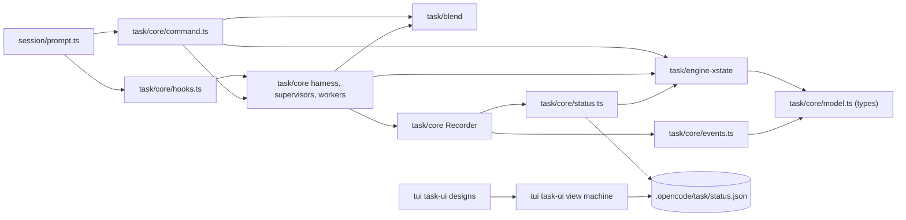
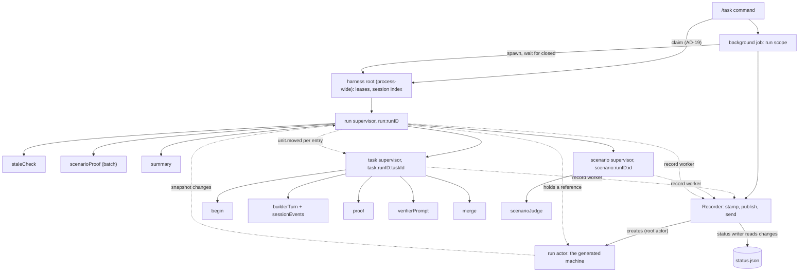
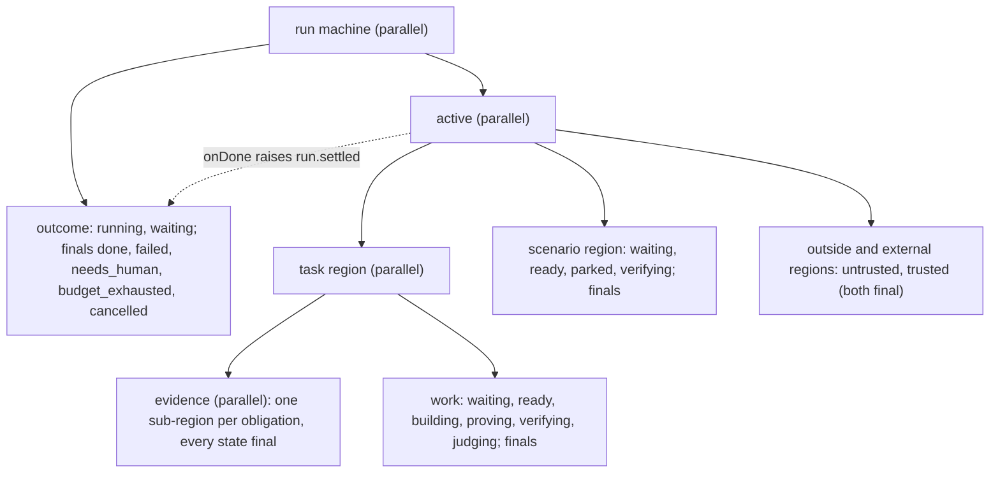

# Architecture Spine — /task harness feedback

## Design Paradigm

**Event-sourced statechart with an actor supervision tree.** The durable lifecycle is a functional core: one
xstate machine, generated per plan, folds the stored facts (D1). Live process supervision is an imperative
shell of xstate actors (D6, D7). Each shell decision becomes a fact, and nothing changes state any other way.
`status.json` is a projection of the machine snapshot (D8). The TUI only reads that file, and its own view
state is a second machine (D16).

| Layer | Lives in | May hold state |
| --- | --- | --- |
| Format and loader | `packages/opencode/src/task/blend/` | no |
| Functional core: machine generator, fold, selectors, fact alphabet | `packages/opencode/src/task/engine-xstate/` | no (pure) |
| Fact store and fact schema | `packages/opencode/src/task/core/events.ts` | durable facts only |
| Imperative shell: harness root, supervisors, workers, Recorder | `packages/opencode/src/task/core/` | only xstate context and state |
| Projection | `packages/opencode/src/task/core/status.ts` | no |
| Session seam (hooks, Ops) | `packages/opencode/src/task/core/hooks.ts`, `ops.ts`; `src/session/prompt.ts` | no |
| TUI view | `packages/tui/src/task-ui/` | only the view machine's context and state |



An arrow means "may depend on". `engine-xstate` imports only `core/model.ts` types, `blend` types and the port.
`packages/tui` never imports `packages/opencode`: it reads `status.json` only. The harness never imports
`SessionPrompt`; it receives `Ops` for each run (AD-18).

## Invariants & Rules

### AD-1 — One generated machine per plan, with a parallel root [ADOPTED D1, D4]

- **Binds:** D1, D4, D5, D8; `engine-xstate`, the projection, the graph test
- **Prevents:** fold code that joins per-unit machines; two encodings of a unit in state ids; `stateIn` lookups
  that break on dotted ids
- **Rule:**
  - `machine(plan)` builds the config as plain data from the plan and exports it, then calls
    `setup(...).createMachine(config)`. No other code builds a machine for a run.
  - The root is `type: "parallel"` with exactly two regions: `active` (`type: "parallel"`, D1's parallel state)
    and `outcome` (AD-4).
  - `active` has one region for each plan task (plan order), then each scenario, then each `outside`
    precondition (kind `outside`), then each external folder dependency (kind `external`, AD-15). Ids sort in
    natural order (the `byId` collator in `task-ui/store.ts`: `S2` before `S10`). `active` has nothing else.
  - A task region is `type: "parallel"`: `evidence` first, with one sub-region for each obligation in plan order,
    then `work`. Each task's `evidence` region is the "obligation group" region of AC 2.
  - Every unit state node has the explicit id `<unit id with "." replaced by "_">/<state>`, for example
    `T1_4/budget_exhausted`. Guards and targets name states only by these ids. The port splits `#id` on `.`
    (verified 2026-10-14).
  - Every unit state node has `meta: { unit, kind, state }`. `kind` is `task | obligation | scenario | outside |
    external | run`, and `state` is the status-contract name (AD-13). The `outcome` states use the unit `run`.
  - Every unit state node has tags `<unit>:<tag>` from a closed vocabulary. Tags spell unit ids as they are, with
    dots (`T1.4:active`, `T1.5:waits:T9`).
    - Class tags: `waiting`, `active`, `ended`, `stopped`, `blocked`, `dead` (AD-13 table).
    - Phase tags, which only the supervisors read: `ready`, `building`, `proving`, `verifying`.
    - Dependency tags: `waits:<dep>` (AD-3).
  - Guards never read tags: they use `stateIn` on the explicit ids.
  - The generator asserts that every explicit id is unique, and dies otherwise: the port keeps the last of two
    equal ids without a warning.
  - The machine stays fold-safe: it uses only `assign` and `raise` with no delay. It has no `after`, `invoke`,
    `spawn` or custom action, because the pure `transition` can run none of them.

### AD-2 — Which states are final

- **Binds:** D2, D3, D4; AC 29 (conformance H3, H16)
- **Prevents:** a run that cannot end because an obligation or an outside precondition is never final; a run that
  ends while a task waits
- **Rule:**

  | Unit | Final | Not final |
  | --- | --- | --- |
  | task (`work`) | `trusted`, `needs_human`, `budget_exhausted`, `failed`, `cancelled`, `blocked` | `waiting`, `ready` (meta state `waiting`), `building`, `proving`, `verifying`, `judging` |
  | obligation | every state: `pending`, `passed`, `failed`, `trusted`, `rejected`, `stale` | — |
  | scenario | `trusted`, `rejected`, `failed`, `cancelled`, `blocked`, `parked` (meta state `waiting`) | `waiting`, `ready` and `verifying` (both meta state `pending`) |
  | outside, external | `untrusted`, `trusted` | — |

  - `trusted` keeps its `obligation.stale` row. A final state inside a parallel region still takes events
    (verified 2026-10-14).
  - `waiting` and `ready` take `task.failed` (3 worker failures before the start) and move to `failed`.
  - A scenario is `parked` when every task it needs is trusted and an outside precondition it needs is not. A
    parked scenario moves to `ready` when that precondition becomes trusted. It moves to `waiting` when a task it
    needs leaves `trusted`.
  - A task that waits on an outside precondition stays in the non-final `waiting` state. The run then waits (D4).

### AD-3 — The cascade and the readiness rows [ADOPTED D2, D4]

- **Binds:** D2, D4, D13; AC 3, AC 5
- **Prevents:** a task or scenario that waits for ever with no reason; readiness or `waitingOn` decided outside
  the machine; an eventless loop
- **Rule:**
  - A task's dependencies are its `afterEffective` ids in plan order, then its children in natural id order. A scenario's
    dependencies are its `needs`. An id that names an `outside` or `external` region names that region's
    `trusted` state.
  - The `blocked` rows: one eventless row for each pair of a dependency and a dead state (`needs_human`,
    `budget_exhausted`, `failed`, `blocked`), in dependency order, then in that state order. Each row's guard is
    `stateIn("#<dep>/<dead state>")`, its target is `blocked`, and its action has the static params
    `{ id, state }`. The first enabled row is therefore the first dead dependency. Its params set
    `blockedBy = { id, state }` and `reason = "blocked by <id>: <state with _ as space>"`, for example
    `blocked by T1.4: budget exhausted`. An action cannot read the configuration, so no action searches for the
    dead dependency.
  - The eventless rows of each state that has not started, in this order:
    - task `waiting`: the `blocked` rows, then `ready` when `and(stateIn(<dep>/trusted))` holds;
    - task `ready`: the `blocked` rows, then `waiting` when a dependency is no longer trusted;
    - scenario `waiting`: the `blocked` rows, then `ready` when every dependency is trusted, then `parked` when
      every task dependency is trusted and an outside one is not (AD-2);
    - scenario `ready`: the `blocked` rows, then `waiting` when a dependency is no longer trusted;
    - scenario `parked`: the `blocked` rows, then `ready` when every dependency is trusted, then `waiting` when a
      task dependency is no longer trusted.
  - No row targets its own source state. The generated config sets `options.maxIterations` to 1 000, so a future
    oscillation fails as a `TransitionError` and never hangs (the port's default is `Infinity`).
  - The generator also writes dependency tags. Each state of a dependency D other than `trusted` carries the tag
    `<U>:waits:<D>` for each dependant U. While U carries `waiting`, its `waitingOn` is the D of each
    `<U>:waits:*` tag.
  - The runner keeps no readiness check and no trust set.

### AD-4 — The run outcome comes from `active.onDone` and is decided in `outcome` [ADOPTED D3]

- **Binds:** D3, D18; AC 4
- **Prevents:** a final run with a non-final unit; outcome code outside the machine (`follows`, `checkDone`); an
  `onDone` target that re-enters `active` and resets every unit
- **Rule:**
  - `active.onDone` has no target: it raises `run.settled`. An `onDone` target in `outcome` re-enters `active` and
    resets every unit region (verified 2026-10-14). Never give it a target.
  - `outcome` has two live states, `running` and `waiting`, and the final states `done`, `failed`, `needs_human`,
    `budget_exhausted` and `cancelled`. Eventless rows move between `running` and `waiting`. The run is `waiting`
    when no task is in `ready`, `building`, `proving` or `verifying` and no scenario is in `ready` or `verifying`;
    a generated `stateIn` guard checks this. Obligations and outside regions do not count. The history records
    neither move.
  - The live `outcome` states take `run.settled`. Each row is also guarded by the generated conjunction "every
    unit region is final", and a last row with no target ignores a `run.settled` that no longer holds (a queued
    done event is not checked again by the port). The guarded rows apply in this order:
    1. If a stop is noted, the outcome is `cancelled` for `run.cancelled`, or the `run.ended` state. Its reason
       is the stop fact's reason.
    2. If a task is in `needs_human`, `budget_exhausted` or `failed`, the outcome is the state of the earliest such
       entry in the history. The reason has one line for each dead task, `<id> <state label>`, then one line for
       each blocked task, `<id> blocked by <id>`.
    3. If every task is trusted and a runnable scenario is `failed` or `rejected`, the outcome is `failed` (owner
       answer, 2026-10-14). The reason has one line for each such scenario, `acceptance not proved: <id> <state>`,
       then one line for each `parked` scenario.
    4. Otherwise, the outcome is `done`. Its reason has one line for each `parked` scenario, and is absent when
       there is none. A `parked` scenario never ran, so it never fails the run.
  - At settle, a scenario is `parked` when its last log entry ends in `waiting`, or it has no entry. Its line is
    `not run: <id> waits on <ids>`, where `<ids>` are its outside needs whose last log entry is not `trusted`, in
    natural order, joined with `, `. Rules 3 and 4 use the same line.
  - Reason lines are joined with `\n`. The action computes the reason from `context.log` (the last entry of each
    unit, and `blockedBy` from its `blocked` entry) and from static plan data (the outside ids). An action cannot
    read the configuration.
  - `run.cancelled` and `run.ended` move each non-final unit state to `cancelled`, with the fact's reason. Each
    non-final unit state has its own row for both events (task `waiting`, `ready`, `building`, `proving`,
    `verifying`; scenario `waiting`, `ready`, `verifying`), so the transition's domain is the unit's own region.
    No ancestor (a region, `active` or the root) has a row for them: one transition with many targets would exit
    and re-enter every region and reset the final units (verified by review). The live `outcome` state takes the
    same event in the same microstep, with a targetless row that notes the stop. `run.started` and `run.resumed`
    add the run's history entry, as today. The machine never takes a refusal: the command writes it (AD-13).
  - The machine reaches status `done` only through this path, and `snapshot.value` keeps each unit's final state.

### AD-5 — History, causes and times come only from machine actions

- **Binds:** D2, D8, D18, D21; AC 3, AC 10
- **Prevents:** history written outside the machine; times derived again from history; history entries with no
  time, out of order, or in a different order after a resume
- **Rule:**
  - Each unit move appends one entry `{ at, unit, from?, to, reason? }` to `context.log`, with the status state
    names. A move whose status name does not change appends no entry: the `waiting`, `ready` and `parked` toggles,
    and `judging`. The primary move of that macrostep is still logged.
  - The entry is appended by the target state's **entry action**, which the port runs in document order. The
    transition's own action only puts `{ from, reason }` in a slot for that unit. Transition actions run in
    activation order, and an actor restored from a snapshot rebuilds that order in document order (verified by
    review, port `src/stateUtils.ts:2699`, `src/StateMachine.ts:1798`), so a log written by transition actions
    would differ between a fold and a resumed run. A targetless row (`task.repeated`, `task.stalled`,
    `task.nudged`, `spec.checked`, the stop note) appends in its transition action, because it is the only move of
    its macrostep. A targetless row that writes context always appends an entry.
  - Every action takes `at` through one helper: `event.at`, or the `at` of the last log entry when the event is a
    raised or done event (verified 2026-10-14: those events have no `at`). The `run.settled` rows always use the
    last log entry, because the macrostep that completes `active` appended a unit entry first. Moves in the
    initial macrostep append no entry.
  - The Recorder stamps `at` inside its permit (AD-9), so `at` never decreases along the log.
  - The context holds `startedAt` and `endedAt` for each unit. A move from a `waiting`-class or `ended`-class state
    into an `active`-class state sets `startedAt` (AD-13 class table). A move into an `ended`-class state sets
    `endedAt`, and a later move out of that class clears it. For a task that is never reopened, `startedAt` is when
    it first leaves `waiting`. A stale reopen of a trusted task starts its clock again, as the task wall clock does
    today. A blocked task never started, so it has no `startedAt`.
  - The run's `startedAt` is the `at` of the slice's `run.started`. Its `endedAt` is the `at` of the last log entry
    when the outcome becomes final.
  - The context holds `spans` for each task: `{ state, from, to? }`, with the status state names. `run.started`
    opens a span for each task in its state at that `at`. Each later move of the task that changes its status name
    closes its open span and opens the next one. A move into an `ended`-class state closes the open span and adds a
    span of the final state with `to` equal to `from`, so no span of an ended task stays open. A retry shows as a
    sequence of `building`, `proving` and `verifying` spans.
  - The projection emits each unit's `tags` in a fixed order (the AD-1 vocabulary order), never in the port's
    configuration order.
  - Tests: (1) fold random facts, including facts after `done`, both by `apply` and by `send` to a live actor, and
    compare; (2) fold a prefix, restore an actor from it, send the suffix, and compare with the full fold; (3) the
    log grows if and only if the value or a context field other than the log changed.
  - No module other than the machine writes these values.

### AD-6 — The engine is a pure fold over snapshots, and resume is that fold [ADOPTED D1, D2]

- **Binds:** D1, D2, D13; AC 2; the command, the run supervisor, the tests
- **Prevents:** state rebuilt from a projection; new fact types for derived states; two fold paths that disagree; a
  slice folded through a plan that did not write it
- **Rule:**
  - The engine API is `initial(plan): RunSnapshot`, then `apply(plan, snapshot, fact): RunSnapshot`, which is pure.
    When nothing changes, the port returns the identical snapshot, and `apply` returns it. It also has selectors
    over a snapshot: `view`, `unitState`,
    `tags`, `waitingOn`, `blockedBy` and `ended`. `State` in `core/model.ts` is only selector output. No function
    takes a `State` to compute a next state. `XStateEngine` keeps its name and its `initial` and `apply` members,
    now over an opaque snapshot, and the engine tests assert through `view`.
  - The engine tests are rewritten as fact sequences through this API (owner answer, 2026-10-14). A committed list,
    in the header of `engine-xstate.test.ts`, puts each old test in one class: **ported** (same facts and
    expectations, asserted through `view`), **re-baselined** (facts or expectations changed, naming the D2, D3 or
    owner ruling that changed them), or **retired** (its input cannot be built any more, naming the guard that
    replaces it, for example "a foreign snapshot dies"). The verifier's AC 2 evidence cites that list.
  - A slice is the facts from one `run.started` to the next. A slice is bound to the plan that started it:
    `run.started` and `run.resumed` gain an optional `path` (the `/task` argument; a stored slice without it is a
    whole-spec slice). Every reader folds a slice only through `machine(plan(slice.path))`.
  - A resume happens only when the latest slice is not ended and its `path` equals the new `/task` path. Otherwise
    the command starts a new slice. A resume folds the latest slice, then records `run.resumed`.
  - `apply` returns its input unchanged when the snapshot's status is not `active`. A live actor drops events
    after `done`, but a pure `transition` on a `done` snapshot still runs a microstep (verified 2026-10-14). This
    rule makes the two agree.
  - `machine(plan)` is memoised by plan identity (a `WeakMap`). `apply` uses that instance and dies when the
    snapshot was made by another machine: a snapshot's nodes belong to the machine that made it, so a rebuilt
    machine silently selects nothing (verified by review). The AD-15 reads use the same memoised machines.
  - Cost, measured by review on a model of the release-notes plan: about 1.4 ms for a fact that changes nothing,
    about 9 ms for a `task.proved` that moves 5 obligations, and about 62 ms for `initial`. A fold of a few hundred
    facts stays near a second. The Deferred snapshot cache applies if a fold grows past a model turn.
  - `initial(plan)` asserts that the status is `active`. A guard on an unknown id gives an `error` snapshot, not a
    failed Effect, so any other status is a defect.
  - No snapshot is persisted, so the stored facts are the only durable state. `ready`, `parked`, `blocked` and the
    outcome are eventless results of existing facts. A stored `run.ended { state: "done" }` folds as a stop
    (AD-4).

### AD-7 — The shape of the graph proof [ADOPTED D5]

- **Binds:** D5; AC 6; the supervisors (AD-8)
- **Prevents:** a proof that passes because its alphabet moves states that no live run moves (for example
  `task.failed` on a waiting task) or because a cancel moves every state; a walk that cannot finish inside
  `bun test`
- **Rule:**
  - The test calls `getAdjacencyMap` from `@jambudipa/xstate-effect/graph` on `machine(plan)`.
  - `events` is the progress alphabet that the engine exports. It is a function of the snapshot, and it uses the
    tags of each unit:
    - A `ready` task gets its start facts (`task.started` for a leaf, `task.proved` for a parent) and `task.failed`.
      Ready scenarios get one `scenario.proved` for their batch.
    - An active task phase gets its outcome facts, with abstract payloads: results all passed or one failed,
      verdicts all trusted or one rejected, and the repetition, `needs_human` and `failed` facts. The walk leaves
      out `task.stalled` and `task.nudged`, which never change a key. The supervisor test keeps them.
    - An active scenario gets one success path only (`scenario.proved` passed, then `scenario.verified` trusted). A
      scenario has no dependants, so its failure outcomes cannot make a state stuck. Unit tests cover AD-4 rule 3
      (a failed or rejected scenario fails the run).
    - An untrusted `outside` region gets `outside.trusted`. An `external` region gets it only in the start-up step
      (AD-15).
    - The alphabet never contains `run.cancelled` or `run.ended`, and every fact has the same fixed `at`.
  - **The key.** `serializeState` lists the units in plan order, each by its machine state key (never `meta.state`,
    which merges `ready` with `waiting`), plus the attempts of each task that has not ended. The main walk keys an
    ended task by its state alone. `JSON.stringify(snapshot.value)` is not a key: its order follows the port's
    configuration. A test lists the context paths that guards read and fails when one is missing from the key.
  - **Main walk.** In phase 1, the release-notes plan and a hand-built plan of the `example-cascade.spec` shape.
    From phase 3, also each `example-*.spec` plan that `Blend.load` accepts and the T1.2 subtree plan of
    `example-outside-run.spec`, which has an AD-15 external region. The alphabet leaves out `obligation.stale`. In
    each state, only the first unit in document order that has a fact gets its facts (a canonical interleaving).
    This is sound for stuck states because no fact outside the chosen unit can disable or change the chosen unit's
    facts: a unit with a fact has only trusted dependencies, and a trusted unit leaves `trusted` only by
    `obligation.stale`. The walk checks that the chosen unit's facts include one that changes the key.
  - **Reduction check.** On a small plan, a test runs the canonical walk and the full walk, with and without the
    `blocked` rows, and requires the same set of stuck states.
  - **Stale walk.** The cascade-shaped plan, with full interleaving, adds `obligation.stale` only for the
    obligations of tasks that are trusted or still in progress. The obligations of dead and blocked tasks are keyed
    as `-`, and ended tasks keep their full key in this walk.
  - `limit` counts dequeued edges, not keys (port `src/graph/adjacency.ts:72`). Each walk sets `limit` to about 3
    times its measured edge count, and each test has an explicit timeout (60 s). The walk asserts that every
    visited snapshot has status `active` or `done`, so a machine error never reads as a stuck state.
  - Measured by review on a model of the release-notes plan: the key as first written gave 24 103 keys and about
    176 s. The key above gives 336 keys, about 1 000 edges and about 8 s. The negative control gives 396 keys and
    33 stuck states in about 4 s. The full interleaving did not finish in 25 minutes. The first phase-1 `[DS]` task
    measures the real machine and sets `limit` from that measurement.
  - A state is stuck when its status is not `done` and no alphabet event changes its key. The test requires 0
    stuck states.
  - Negative control: the test copies the plain-data config and removes the AD-3 `blocked` rows (not the states
    that guards name). The copy must give the observed stuck state: T1.1–T1.3 trusted, T1.4 `budget_exhausted`,
    T1.5 and T1 `waiting`.
  - For a unit in a given state, a supervisor records only facts in this alphabet (with any payload), plus
    `task.stalled`, `task.nudged`, the facts that move no unit (`run.started`, `run.resumed`, `spec.checked`), the
    run-level stops, and `obligation.stale`. A supervisor test checks this.
  - [ASSUMPTION] D5's "every reachable state" means every state reachable under this alphabet with the canonical
    interleaving. The full interleaving of the release-notes plan does not finish.

### AD-8 — The actor topology, where `system.get` replaces the registry [ADOPTED D6, D7]

- **Binds:** D6, D7, D12, D18; AC 8, AC 9; `command.ts`, `prompt.ts`
- **Prevents:** two owners of a live run; a process-wide map beside the actors; supervisors that move the
  lifecycle or act on a phase the run already left
- **Rule:**
  - One process-wide root actor, `harness`, exists. A scoped service (`TaskHarness`) in the app runtime creates it,
    and its actor system is the only registry. The system ids are `run:<runID>`, `task:<runID>:<taskId>` and
    `scenario:<runID>:<scenarioId>`. The harness root also holds the directory leases (AD-19) and the session index
    (AD-11).
  - `TaskHarness.node` depends on `Session`, `SessionStatus`, `InstanceStore`, `EventV2Bridge`, `BackgroundJob` and
    `Database`, because in 0.2.0 `createActor` requires the services that a machine's actions and actors use. It
    never depends on `SessionPrompt`. `SessionPrompt.node` depends on `TaskHarness.node`, and `Ops` stays an
    argument of each run.
  - **The run's lifetime.** After a claim (AD-19), the command starts the background job. The job opens the run
    scope and adds the lease release as its first finalizer. It builds the Recorder there (which creates the run
    actor and the status writer, AD-9), then adds the cancel finalizer, then asks the harness root to spawn the
    **run supervisor**. The job body waits for the run supervisor's final state, then closes the run scope.
  - The cancel finalizer belongs to the run scope, so it runs before the Recorder, the run actor and the writer
    close. When the job's status is `cancelled`, it records `run.cancelled`, waits for the run supervisor to be
    final within `limits.cancelDeadline`, then stops it. The run scope closes only after the supervisor is final or
    stopped. A test cancels a job whose supervisor is in `staleCheck` and requires `run.cancelled` in the store and
    in the file.
  - The run supervisor's first state records `run.started` or `run.resumed` through a `record` worker and defers
    every other event. It is registered under `run:<runID>` before it reads the directory aggregate's trusts.
  - The run supervisor is `type: "parallel"`. Its `main` region holds the reference to the run actor, the current
    spec (AD-12), the unit supervisors, the `scenarioProof` actor for the batch of `ready` scenarios, and the
    `summary` actor when the outcome is final (AD-18); its final state is `closed`. Each timer is its own region:
    - `heartbeat`: `beating` goes to `touching` after 5 s; `touching` invokes the `touch` worker, and its `onDone`
      and `onError` go back to `beating`;
    - `wallClock`: one delayed transition that invokes a `record` worker for `run.ended`;
    - `staleCadence`: `waiting` goes to `checking` after 1 s; `checking` invokes `staleCheck` and goes back.
  - No transition in one region targets a state of another region, and no timer row uses `reenter`, so a stale
    cycle never restarts the heartbeat. Each timer region moves to a final `stopped` state when the run actor's
    status is `done`. A test holds `staleCheck` on the checkout lock, advances the clock by 5 s, and requires one
    touch.
  - `touch` is fire-and-forget: it offers to the Recorder's `Queue.sliding(1)` and returns. A touch after the run
    scope closed returns `void`. A `touch` failure is logged, never counts toward a failure rule, and never records
    a fact.
  - The **run actor** is the generated machine as an actor. The Recorder creates it with
    `createActor(machine(plan), { snapshot: fold })` in the run scope, before the run supervisor is spawned. It is
    a root actor, because a spawned child cannot start from a snapshot. It is the only holder of the live snapshot,
    and it has no `systemId`. The run supervisor gets a reference to it as input.
  - Only the run supervisor spawns and stops unit supervisors, and it reads the run actor's tags to do so. It
    spawns a **task supervisor** for each task tagged `ready` or `active`, and a **scenario supervisor** for each
    scenario in `verifying`. A unit has at most one supervisor at a time. The supervisor lives while the unit
    moves among those tags, and it stops when the unit leaves them.
  - The run supervisor sends `unit.moved { unit, entry, state, tags }` to a unit's supervisor once for each new
    history entry of that unit, not for a diff of `snapshot.value`. `entry` is the entry's index in the log,
    `state` is the machine state key, and `tags` are the unit's own class and phase tags without the `<unit>:`
    prefix. A supervisor branches only on phase tags and starts the phase's work again on each new `entry`. A unit
    supervisor never reads the run actor to choose its phase. A worker that needs a wider view reads the run
    actor's snapshot through the engine selectors.
  - Unit supervisors hold only live-process state: turns in flight, the D7 watch timers and counters, retries, the
    verifier round's sub-states, and the task wall clock. After a supervisor records the fact that ends a phase,
    it waits in a quiet state, with no watch timer, until a `unit.moved` with a new `entry` arrives. After 3 worker
    failures in a row, the supervisor records `task.failed`, or the scenario's fact, with the reason
    `harness error: …`. A unit supervisor moves the lifecycle only by recording a fact.
  - The verifier round is a sub-state of its owner: `ask`, `collect`, `askMissing`, `collect`. Each worker runs one
    prompt and returns. The owner clears `verdicts` at the start of each ask.
  - Workers hold no state: `begin`, `builderTurn`, `sessionEvents` (a `fromCallback` actor, AD-11), `proof`,
    `verifierPrompt`, `merge`, `scenarioProof`, `scenarioJudge`, `staleCheck`, `record` and `summary`. To stop a
    worker, its parent interrupts its Effect. The Effect's finalizer cancels its session turn within
    `limits.cancelDeadline`.
  - `running(runID)` is true when `system.get("run:<runID>")` is `Some`.
  - For `/task trust <id>`, the command records the fact on the directory aggregate, then sends it to the harness
    root. The harness root forwards it to the run supervisor of that directory. That supervisor records
    `outside.trusted` only when its machine has an untrusted region `<id>` of kind `outside`, never `external`. A
    region that is already trusted ignores a second trust.



### AD-9 — Facts enter only through the Recorder

- **Binds:** D6, D7, D8, D12
- **Prevents:** a fact stored but not folded, a fact folded twice, a different fact order in the store and in
  the run actor, and a `status.json` that lags one fact behind
- **Rule:**
  - Each run has one Recorder, an Effect service that the background job builds in the run scope, outside every
    actor. The Recorder creates the run actor (AD-8) and owns it. The run scope outlives the run supervisor.
  - `record(fact)` is uninterruptible from its first step to its last. It holds the Recorder's single permit while
    it does three steps in order: it stamps `at` from `Clock.currentTimeMillis`, publishes the fact to the run
    aggregate (EventV2), and sends the fact to the run actor. Callers pass a fact without `at`.
  - The send only puts the fact in the run actor's mailbox, which is FIFO (port `src/Actor.ts`, the mailbox
    envelope). So the store order and the fold order are the same.
  - Once the run actor's status is `done`, `record` stores nothing and returns (AD-6).
  - A status-writer fiber, forked in the run scope when the Recorder is built, is one `Stream.runForEach` over
    `Stream.merge(runActor.changes, touches, { haltStrategy: "left" })`, with a `Stream.scan` that holds the last
    snapshot it consumed. It writes `status.json` for each committed macrostep, the final one included. A touch
    rewrites exactly the last consumed snapshot and never calls `getSnapshot`, so the file never goes back a step.
    The writer writes the `done` snapshot, then ends with `changes`; no write follows it. `TaskStatus.write` stamps
    `run.aliveAt` from `Clock.currentTimeMillis` on each write. No other code writes `status.json` during a run.
  - `record` runs only in a worker's Effect or in a plain Effect outside every actor. Never call it from an action,
    a guard, a delayed transition or a subscribe callback: a supervisor that must record invokes a `record` worker.
  - Supervisors and workers record facts only through the Recorder. No other code sends a fact to the run actor.
  - Only `/task trust` writes to the directory aggregate.
  - A send made from inside actor processing only queues the event (port `src/ActorRef.ts:149-155`). So no code
    reads an actor's snapshot directly after such a send to learn its effect.

### AD-10 — The fact list

- **Binds:** D2, D7, D12, D13; the `FactSchema` in `events.ts`; the supervisors; the AD-7 alphabet
- **Prevents:** two emitters of one decision; a new fact type for a derived state
- **Rule:** each of the 16 existing fact types keeps its shape, except for one additive optional field (`path` on
  `run.started` and `run.resumed`, AD-6). Two new members extend the `FactSchema` union. Stored runs therefore
  still decode.

  | Fact | Payload besides `type`, `at` | Emitted by | Effect in the machine |
  | --- | --- | --- | --- |
  | `run.started` | `base?`, `path?` | run supervisor, fresh slice | run history entry; opens the task spans |
  | `run.resumed` | `base?`, `path?` | run supervisor, resume | run history entry `resumed` |
  | `outside.trusted` | `id` | `/task trust` on the directory aggregate. On the run aggregate, the run supervisor: for `outside` regions, at start for each directory-recorded id and on a forwarded trust; for `external` regions, only in the start-up step (AD-15) | the region to `trusted` |
  | `task.started` | `task, worktree, branch, base, session` | task supervisor (`begin`), leaf in `ready` | `ready` to `building` |
  | `task.ready` | `task, head` | task supervisor (`builderTurn` with `task_ready`, or after the last nudge) | `building` to `proving` |
  | `task.proved` | `task, results[], reason?` | task supervisor (`proof`; a parent's review proof in `ready`; no `task_ready` after the last nudge) | obligations; to `building`, `verifying` or `budget_exhausted` |
  | `task.verified` | `task, verdicts[]` | task supervisor (after its verifier round, and after a `merge` that passes for a trusted leaf) | obligations; `verifying` to `judging` and onward |
  | `task.stalled` | `task, reason` | task supervisor: stream-idle delayed transition | history entry only |
  | `task.repeated` | `task, reason` | task supervisor, when a turn that took `hook.repeated` ends (AD-11) | `building` again with one more attempt, or `budget_exhausted` |
  | **`task.nudged`** (new) | `task, nudge: 1 \| 2, reason` | task supervisor: the turn went idle without `task_ready` and a nudge is left | history entry only (`building` to `building`) |
  | `task.needs_human` | `task, reason` | task supervisor: spend-cap guard, reason `spend cap: …` | to `needs_human` |
  | `task.failed` | `task, reason` | task supervisor: no verdict, a merge failure, a missing session, the task wall clock, or 3 worker failures | to `failed` |
  | `obligation.stale` | `id, hash` | run supervisor, from the `staleCheck` result (AD-12) | obligation to `stale`; a trusted task to `proving` |
  | **`spec.checked`** (new) | `failures: { rule, path, message }[]` | run supervisor, from the `staleCheck` result, only when the failure list differs from the run's current warning | sets the run warning, or clears it when the list is empty; run history entry |
  | `scenario.proved` | `id, status, reason?` | `scenarioProof` (run supervisor), or 3 worker failures for its batch | `ready` to `verifying` or `failed` |
  | `scenario.verified` | `verdict` | scenario supervisor (after its judge round), or 3 worker failures | `verifying` to `trusted` or `rejected` |
  | `run.cancelled` | `reason` | background-job finalizer, when the job is cancelled | stop (AD-4) |
  | `run.ended` | `state, reason?` | run supervisor: run wall clock (`failed`). `done` is no longer recorded, and a stored one folds as a stop | stop (AD-4) |

  These facts carry the decisions that D7 names:
  - A stall is `task.stalled`.
  - A spend cap is `task.needs_human`.
  - A nudge is `task.nudged`.
  - Idle is the cause of `task.nudged`. After the last nudge, the existing `task.ready` and a failed `task.proved`
    (`the builder ended without task_ready`) record it.
  - A spec that does not validate is `spec.checked`.

  The reuse of `task.stalled` and `task.needs_human` is deliberate: no decision reads which cause it was, and the
  reason text is for display only. No reader parses a reason.

### AD-11 — Hooks route by session to the owning supervisor, and the watch is event-driven [ADOPTED D7]

- **Binds:** D7, D9; AC 9; `prompt.ts`, the harness tools, `core/hooks.ts`, `core/sessions.ts`
- **Prevents:** hook maps beside the actors; a polled watch loop; a repetition stop that reads a stale snapshot;
  hooks lost from a resumed session
- **Rule:**
  - The context of the harness root holds the session index `{ [sessionID]: { owner: systemId, watch: boolean } }`.
  - The owner claims a session before the first prompt of every turn it runs in that session, whether the
    session is new or reused (a resumed builder, a respawned supervisor). The worker sends
    `session.claim { session, owner, watch }` to the harness root and waits (`waitFor` on the root) until the index
    holds the entry, then prompts. When the harness root removes `run:<runID>`, it removes every entry of that run.
  - `SessionPrompt` resolves `TaskHarness` and passes a `HarnessHooks` value (`ownerOf(session)`, `send(event)`,
    `limitOf(session)`) into `createTaskHarnessTools(agent, sessionID, hooks)` and into the repetition check. The
    functions in `hooks.ts` take that value as an argument. No module of `src/task/` holds a reference to the root.
  - `TaskHooks` keeps only its constants, `shellEnvironment`, the pure check `repetition(limit, calls)`, and
    stateless functions over `HarnessHooks`. They send one of these events to the owner:
    `hook.ready { session, summary? }`, `hook.verdicts { session, verdicts }` or
    `hook.repeated { session, reason }`. A session with no owner is not watched. For that session, the tool records
    nothing and says so.
  - The owner holds `ready`, `verdicts`, `repeated`, the repetition `limit` and the nudge count in its context. The
    owner is the task supervisor, or the scenario supervisor for a judge session.
  - The repetition stop: for a session with `watch: true`, `prompt.ts` reads `limit` from the owner's snapshot
    (with no send before the read), runs `repetition(limit, calls)` over the session's own tool calls, and on a
    match ends the turn and sends `hook.repeated`. The owner records `task.repeated` when the turn ends. A
    synchronous read-back after a send is not used, because a send from inside actor processing only queues
    (AD-9).
  - The harness tools' `execute` callbacks are async: they run the hook Effect with the context that
    `createTaskHarnessTools` captures.
  - The builder watch is event-driven:
    - The `sessionEvents` actor is a `fromCallback` actor. It runs the Effect streams of the session's part events
      and of `SessionStatus.Event.Status` (not the deprecated `Event.Idle`), and it relays them with `sendBack` as
      `turn.activity`, `turn.tool { running }` and `turn.status { type, message? }`. (`fromStream` would deliver
      snapshots, not typed events.)
    - A stall is an `after: streamIdle` transition. `turn.activity` is a self-transition with `reenter: true`, so
      it restarts the timer. The timer is absent while a tool runs.
    - A spend cap is a guard that matches `SPEND_CAP` in either place: a `retry` status message during the turn,
      or the turn's assistant error when the turn ends. An HTTP 429 arrives as a retry status. A stream
      `insufficient_quota` error is not retryable and arrives only as the assistant error (conformance H14b).
      Either match records `task.needs_human` before any nudge.
    - Idle is `SessionStatus.Event.Status` with `type: "idle"`, which ends the turn.
    - After a stall, the task supervisor cancels the turn, records `task.stalled`, and prompts again in the same
      attempt with the continue message. A stall spends no nudge and no attempt (conformance H12).
    - The watch uses no poll and no `Ref`.

### AD-12 — The plan is fixed, and the current spec is supervisor context [ADOPTED D12]

- **Binds:** D12, D6; AC 14
- **Prevents:** a `Ref` that holds the spec; a machine that changes during a run; a reload failure that nobody sees;
  a proof against text the user replaced
- **Rule:**
  - The generator builds the machine once for each run, from the plan that the command loaded.
  - The current spec (texts and hashes) is in the run supervisor's context. Unit supervisors get it when they are
    spawned, and in a `spec.reloaded` event.
  - `staleCheck` reads the spec under the directory's checkout lock (AD-19), records nothing, and returns
    `{ spec, stale[], failures }`. In one transition, the run supervisor first assigns the new spec (only when it
    validates) and sends `spec.reloaded`, then invokes a `record` worker for `obligation.stale` and `spec.checked`.
  - Workers prove and judge exactly the plan's obligation ids. The current spec gives only the texts and hashes of
    those ids. A valid reload that adds or removes an obligation id of the plan counts as a `spec.checked` failure,
    and the run keeps the old text.
  - A reload that does not validate keeps the plan and the spec, and records `spec.checked` with its failures.
    The next reload that validates records `spec.checked` with no failures, which clears the warning.

### AD-13 — The `status.json` contract

- **Binds:** D8, D10, D12, D16, D17, D19, D20, D21, D18; the TUI store; the conformance suite
- **Prevents:** a TUI or a summary that classifies units again; a projection that adds state; two readers that
  decode one file differently
- **Rule:**
  - `status.json` is `project(plan, snapshot)`, or the command's refusal form (AD-14).
  - The projection reads only the snapshot's meta, tags and context, plus static text from the plan's spec: the
    titles, the spec id and the path. `waitingOnOutside` is `waitingOn` filtered to the keys of `outside`. The one
    exception is `run.aliveAt`: `project` never emits it, `TaskStatus.Status` declares it optional, and
    `write(directory, status, aliveAt?)` stamps it, because the Effect encoder drops a key that the schema does not
    declare (verified by review). The shared fixture is written by `write` with a fixed clock.
  - `run.aliveAt` is the heartbeat of the live job that owns the run. The TUI cannot read background jobs: they
    publish no bus event and are not in the TUI's sync state. The run supervisor asks for a write every 5 s, so a
    reader treats the run as owned by a live job while the status is not ended and `now - run.aliveAt <= 15 s`.
    A run that waits on `/task trust` keeps its heartbeat. A run whose server stopped loses it.
  - Status tags are a subset of `active | waiting | ended | stopped | blocked | dead`. `stopped` marks an ended
    unit that is not trusted. `dead` marks D2's dead set: a task in `needs_human`, `budget_exhausted` or `failed`.
    The phase tags and the `waits:` tags never appear in the file.
  - The field names are fixed:

```ts
type Tag = "active" | "waiting" | "ended" | "stopped" | "blocked" | "dead"
type Cause = { id: string; state: string }
type Span = { state: string; from: number; to?: number }

interface Status {
  run: {
    state: "running" | "waiting" | "refused" | "done" | "cancelled" | "needs_human" | "budget_exhausted" | "failed"
    tags: Tag[]
    reason?: string // the outcome reason, one line per item (AD-4); a refusal: one line per failure (AD-14)
    warning?: string // the latest spec.checked failures, one line each (AD-14); absent when none
    spec: string // the spec folder, relative to the directory
    specId: string // the spec id: the folder name
    path: string // the /task argument
    title: string // the SPEC.md H1; specId when the H1 is empty or the spec did not load
    task?: { id: string; title: string } // a subtree run's root task: the only task title in the file
    startedAt?: number // the at of the slice's run.started
    endedAt?: number // the at of the last log entry when the outcome became final
    aliveAt?: number // the heartbeat: epoch ms of the status writer's latest write (AD-9)
  }
  tasks: Record<string, {
    state: string // waiting | building | proving | verifying | trusted | needs_human | budget_exhausted | failed | cancelled | blocked
    tags: Tag[]
    attempts: number
    waitingOn: string[] // every id the task waits on: plan tasks, outside and external (AD-3); [] unless tagged waiting
    waitingOnOutside: string[] // the ids of waitingOn that are keys of outside
    worktree?: string
    reason?: string // for a blocked task: "blocked by <id>: <state>"
    blockedBy?: Cause
    startedAt?: number
    endedAt?: number
    spans: Span[] // the task's phases as the machine recorded them (AD-5)
  }>
  obligations: Record<string, { state: string; tags: Tag[]; reason?: string; startedAt?: number; endedAt?: number }>
  scenarios: Record<string, {
    state: string // waiting | pending | trusted | rejected | failed | cancelled | blocked
    tags: Tag[]
    title: string // the loader's scenario title, with no leading id
    waitingOn: string[]
    waitingOnOutside: string[]
    reason?: string
    blockedBy?: Cause
    startedAt?: number
    endedAt?: number
  }>
  outside: Record<string, { state: "untrusted" | "trusted"; tags: Tag[] }> // spec outside preconditions
  external: Record<string, { state: "untrusted" | "trusted"; tags: Tag[] }> // folder tasks outside a subtree run
  history: Array<{ at: number; unit: string; from?: string; to: string; reason?: string }>
}
```

  | Kind | Machine state (status `state`): class tags |
  | --- | --- |
  | task | `waiting`, `ready` (shown as `waiting`): `waiting`. `building`, `proving`, `verifying`: `active`. `trusted`: `ended`. `cancelled`: `ended`, `stopped`. `needs_human`, `budget_exhausted`, `failed`: `ended`, `stopped`, `dead`. `blocked`: `ended`, `stopped`, `blocked` |
  | obligation | `pending`, `stale`: `waiting`. `passed`, `failed`, `rejected`: `active`. `trusted`: `ended` |
  | scenario | `waiting`, `parked` (shown as `waiting`): `waiting`. `ready`, `verifying` (both shown as `pending`): `active`. `trusted`: `ended`. `rejected`, `failed`, `cancelled`: `ended`, `stopped`. `blocked`: `ended`, `stopped`, `blocked` |
  | outside, external | `untrusted`: `waiting`. `trusted`: `ended` |
  | run | `waiting`: `waiting`. `running`: `active`. `done`: `ended`. `refused` and each other final outcome: `ended`, `stopped` |

  - The status vocabulary keeps today's names and adds `blocked`, plus `cancelled` for scenarios. `ready` and
    `parked` never show under their own names. `stalled` stays in the vocabulary, but no state is called
    `stalled`: a stall keeps the task `building`. `judging` never shows: its last eventless row has no guard, so it
    settles within the macrostep.
  - No task title is in the file except `run.task.title` (D17 adds only the run title, and D20 adds only the
    scenario title).
  - The run header in the session comes from a structured field, never from parsed text (D17). The command's first
    message is `Implementing spec **<title>**`, or `Implementing **<task id> <task title>** from spec **<title>**`
    for a subtree run. Its text part carries
    `metadata.taskHarness = { header: { spec: { id, title }, task?: { id, title }, leftOut: string[] } }`. The TUI
    draws that message's header from its own metadata and never from `status.json`, so an older header in the
    scrollback keeps its title. `Ops.PromptInput` text parts gain an optional `metadata` for this. The task-ui
    surfaces that show the current run's title (the Ledger and the full-screen header) read `run.title`.
  - `cost` is not in the file. The TUI and the summary read it from session data (D24, AD-18).
  - An absent optional value is an absent key, never `undefined` or `null`: `metadata` is JSON.
  - The TUI decodes `state` and `tags` as open strings and ignores an unknown tag. Every field that is new in this
    contract is optional when the TUI reads it, so a file from before the change still parses. An opencode test
    writes a fixture with `project`, and a TUI test decodes that fixture with the TUI schema.
  - The selectors read tags with `snapshot.hasTag`. In the port, `snapshot.tags` is an array, not a `Set`.

### AD-14 — Refusal and warning lines [ADOPTED D10, D12, D13]

- **Binds:** D10, D12, D13; AC 12, AC 14, AC 15, AC 16
- **Prevents:** a refusal that shows only the first failure; two formats for one failure list
- **Rule:**
  - Each failure is one line, `<rule> <path>: <message>`. A loader failure uses `R<n>` as its rule. A refusal that
    no rule names (for example the git checkout check) is one plain line.
  - A D13 refusal line is `R12 <run task's folder, relative to the spec>: <task id> is after <other id>, which is
    outside this run and not trusted`. [ASSUMPTION] It uses R12, the runtime precondition rule.
  - `run.reason` holds only the failure lines, in loader order, joined with `\n`. The refusal session message is
    one header line, then exactly the lines of `run.reason`, then one optional hint line. `bmad-ux` sets the header
    and hint text.
  - `run.warning` uses the same line format for the latest `spec.checked`.

### AD-15 — Subtree runs and folder tasks outside them [ADOPTED D13]

- **Binds:** D13; AC 15; the command, the generator, the run supervisor
- **Prevents:** a subtree run that waits for ever on a task outside it; a trust from a set written by hand; a
  hand-typed `/task trust` that trusts a folder task
- **Rule:**
  - The plan of `/task <spec>/<task folder>` adds one region of kind `external` for each folder task outside the
    run that a run task is after.
  - The command reads the trust of each such task by folding stored slices, each through its own plan's machine
    (AD-6). The latest slice whose plan holds the task, as a task region or as an external region, decides. The
    command never reads trust from a set written by hand.
  - If such a task is not trusted, the command refuses the run at the start and names both tasks (AD-14).
  - If such a task is trusted, the run supervisor records `outside.trusted` for its external region directly after
    `run.started` or `run.resumed`. No other path moves an external region: a forwarded `/task trust` and the
    directory aggregate's trusts reach only `outside` regions.
  - A subtree run that leaves scenarios out names them in its start message.

### AD-16 — The task-ui view machine [ADOPTED D16]

- **Binds:** D16, D9, D19, D20, D21, D23; AC 18; `packages/tui/src/task-ui/`
- **Prevents:** view state in signals; a lifecycle encoded again in the TUI; timers and polls outside the machine
- **Rule:**
  - Each plugin instance has one `taskView` actor. `start()` creates it, and it stops with the reactive root.
  - The context holds `design` (1–7), `chosen?` (a task id), `status?`, `mtime`, `logs`, `now`, `root` (the root
    session on screen) and `target` (the session in the watch frame; `""` for the root's own transcript). These
    replace the `root` signal in `index.tsx` and the `target` signal in `watch.tsx`.
  - The parallel regions are:
    - `feed`: `reading` invokes one read of the status text, its mtime, the proof logs and the clock, then goes to
      `resting`. `resting` goes back to `reading` after 1 s. A text that does not parse keeps the last status.
    - `expansion`: `collapsed` and `expanded`.
    - `watch`: `off` and `on`.
    - `stopKey`: `stop.key` in `disarmed` runs the warn action and goes to `armed`. `stop.key` in `armed` runs the
      stop action and goes to `disarmed`. `armed` also goes to `disarmed` after 5 s.
    - `liveness`: eventless rows in this order: `absent` (no status), `ended` (the run's `ended` tag), `live`
      (`now - run.aliveAt <= 15 s`, AD-13), else `still` (the heartbeat is older, or absent in a file from before
      this change). Liveness reads no ownership. Each key that acts on the run checks ownership itself, as
      `registerTab` does today.
  - The events are `design.set { id }`, `design.cycle`, `select { id }`, `select.next`, `select.previous`,
    `select.nextRunning`, `select.previousRunning`, `expand.toggle`, `expand.set { open }`, `watch.toggle`,
    `watch.set { on }`, `stop.key`, `sessions.changed { owns, updated }`, `route.changed { session, parent? }` and
    `watch.target { session, keep }`. `target` keeps its value while nothing runs, and `watch.set { on: false }`
    resets it to `""`.
  - Every periodic read and every timer in `task-ui` is a delayed transition of this machine: the 1 s status feed,
    the session list (today 2 s), the activity lines (today 1.5 s) and the proof-log tail (today 500 ms) each have
    their own. `task-ui` contains no `Effect.repeat`, `Schedule`, `Effect.sleep` or `setInterval`. The D23 diamond
    uses the `opentui-spinner` element's own timer.
  - One adapter, `fromActor(actor)`, subscribes to the actor's snapshot stream and sets one Solid signal. The
    designs read view state only through this adapter and pure selectors over its snapshot.
  - Each classification reads the status tags: liveness, active, ended, blocked, waiting, which task to focus, the
    next running task, the severity order (`dead`, then `blocked`, then `stopped`, then `active`, then `waiting`,
    then `ended`) and the counts. The Board column also comes from the tags: `waiting` goes to WAITING; `active`
    goes to the column of its phase, with the state as a display key; `stopped` goes to STOPPED (grouped by
    `dead`, then `blocked`, then the rest); `ended` without `stopped` goes to TRUSTED.
  - The run reason line uses the error tone only when the run carries `stopped`. On a `done` run (for example a
    `not run` line), it uses the muted tone, and the Ticker raises no notification for it.
  - The only table keyed by state names in `task-ui` is the display table (state to glyph and tone). A design uses
    a unit's `state` only as a key into that table.
  - A `waitingOn` id that is a key of `outside`, with state `untrusted`, shows the D4 hint
    `waiting on <id> (outside) — run /task trust <id>`. An id that is a key of `external` never shows a trust
    command. `bmad-ux` sets its text.
  - The Gantt draws each task's lane from `tasks[].spans` (AD-5). An open span runs to `now`. Before a task's first
    span, the lane is blank. The Gantt infers no state and shows no default state. `bmad-ux` sets its look.
  - A run whose server stopped records no fact: the process cannot record one, and the run must stay resumable
    (AD-6). [ASSUMPTION] The D23 diamond animates and the D21 live durations count only while `liveness` is
    `live`. In `still` and `ended`, the diamond is static and the durations stop (prepare-goal default,
    2026-10-14). A run that waits on `/task trust` inside a live job stays `live`. This adds a static case to D23
    and AC 25 and stops a D21 duration (AC 23) for a run whose server stopped, so it needs the owner's ruling.
  - D16 adds `@jambudipa/xstate-effect` to `packages/tui/package.json` as `catalog:`, which is the root pin 0.2.0.

### AD-17 — The D9 audit allowlist [ADOPTED D9]

- **Binds:** D9; AC 11
- **Prevents:** an allowlist that grows without a reason; a needed exception that blocks the audit
- **Rule:** each allowlist entry names one identifier in one file, and the audit matches the file and the
  identifier. The audit expects only these entries, and each entry carries its reason. The identifier names are
  seed: the code may rename them, but each entry still names one identifier.

  | Identifier | File | Reason |
  | --- | --- | --- |
  | `fromActor` | `packages/tui/src/task-ui/actor.ts` | Solid renders only from signals. It copies the view actor's snapshot and decides nothing. |
  | `DISPLAY` (state to glyph and tone) | `packages/tui/src/task-ui/store.ts` | It is a presentation lookup. Each classification reads tags (AD-16). |
  | `RunStateSchema`, `TaskStateSchema`, `ObligationStateSchema`, `ScenarioStateSchema`, `OutsideStateSchema` | `packages/opencode/src/task/core/status.ts` | They are the contract's encode and decode vocabulary, not a classification. |
  | `DEAD` (the states that block a dependant) and `CLASS` (the class tags of each state) | `packages/opencode/src/task/engine-xstate/machine.ts` | They are the machine's definition, and only the generator reads them. |
  | `FactSchema` literal members (`run.ended` state, verdict, result status) | `packages/opencode/src/task/core/events.ts` | They are the stored-fact vocabulary, not a classification. |
  | `appender` (the proof-log flush, `Effect.repeat(Schedule.spaced(logInterval))`) | `packages/opencode/src/task/proof/process.ts` | It copies process output to the log file inside one proof process's scope. It holds no lifecycle state. |
  | `awaitGroupGone` (a bounded poll for a process group to exit) | `packages/opencode/src/task/proof/process.ts` | Operating-system teardown inside one proof process, bounded by `Effect.timeoutOption`. It holds no lifecycle state. |
  | `mergeRetry`, only if the audit's polled-loop rule matches `Schedule` | the `merge` worker in `packages/opencode/src/task/core/workers.ts` | One I/O call inside one worker, with no lifecycle meaning. |

  The audit's polled-loop rule matches `while (true)`, `Effect.repeat`, `Effect.forever`, `Schedule.spaced`,
  `Schedule.fixed`, `Stream.tick` and `setInterval`. An xstate `after` row, a `Queue` and a `Stream.scan` are not
  on the D9 list and need no entry. `Semaphore` (the record lock, and the checkout and git locks of AD-19) is not on
  the D9 list either.
  Each `Ref`, `MutableHashMap`, `FiberMap`, `while (true)`, tick counter, module-level `let`, and the lists
  `ACTIVE`, `ENDED` and `JUDGED` goes.

### AD-18 — The closing summary and the `Ops.say` seam [ADOPTED D18, D24]

- **Binds:** D18, D24; AC 20, AC 26; `ops.ts`, `SessionPrompt`
- **Prevents:** a harness that imports `SessionPrompt`; a summary from a model call; a summary cut off by the end of
  the job; two definitions of "the run's sessions"
- **Rule:**
  - When the run actor's snapshot status is `done`, the run supervisor invokes the `summary` actor once, then
    enters `closed` (AD-8).
  - The run's sessions are the child sessions of the run's root session. The `summary` actor and the TUI (D24) use
    this one definition.
  - The `summary` actor builds markdown from `project(plan, snapshot)` and from the summed tokens and cost of the
    run's sessions, a query of the session store. The markdown holds the D18 content: the outcome; each failed,
    exhausted or blocked task with its reason or upstream cause; each rejected or failed scenario with its reason;
    each task's duration; and the run's cost. The summary prints `run.reason` under the outcome line. A line about a spec that stopped validating reads the slice's
    `spec.checked` history entries, not `run.warning`.
  - On a cancel, `run.cancelled` moves every active unit to `cancelled` at once. The task supervisors stop, and
    their workers' finalizers end the session turns and processes while the summary is written.
  - The actor writes the markdown through a new member, `Ops.say({ sessionID, text }): Effect<void>`. `say`
    appends one assistant-role text message to the root session, with no model call. `SessionPrompt` implements
    `say`. The message is a complete `SessionV1.Assistant`: `parentID` is the run header message, `modelID` and
    `providerID` are the session's current model, `cost` and `tokens` are zero, `time.completed` is set, and
    `finish` is `"stop"`. `say` waits behind any turn of the root session in flight (the session's run lock), and it
    still writes after the user aborts the root session.

### AD-19 — One directory lease: a run claim, one status writer, shared locks

- **Binds:** D6, D10, D12, D13; AC 10, AC 14; `command.ts`, the harness root, the Recorder, the workers
- **Prevents:** two runs that write one `status.json`; a refusal that overwrites a live run's file; two commands
  that start the same run; a claim that is never released; checkout and git locks scoped to the wrong owner
- **Rule:**
  - The lease is per opencode server process: the harness root holds one lease for each directory. A lease holds
    the live run's id, spec and path, the root-checkout lock and the git lock (`Semaphore`s). Two servers in one
    directory are out of scope (Deferred).
  - The harness root answers two events, each sent from outside every actor so that the sender can read the
    result. `run.live { directory }` reads the lease and returns `none` or `{ runID, spec, path }`; it changes
    nothing. `run.claim { directory, runID, spec, path }` returns `claimed` or `busy { runID, spec, path }`. `spec`
    is the spec folder relative to the directory (as `run.spec`), and `path` is the `/task` argument (as
    `run.path`).
  - The command runs its checks in this order: usage, loader (D10), task folder (R2), `run.live`, git readiness,
    unfinished base, D13, `run.claim`, then `BackgroundJob.start`. When `run.live` is not `none`, the command
    answers the busy line and starts nothing. A loader or R2 refusal while a run is live answers its failure lines
    in the session only and writes no file.
  - The claim is the last step before `BackgroundJob.start`. If the start does not run the job (an error, or a job
    of that id already running), the command sends `run.release { directory, runID }` in the same `Effect.onExit`.
    A test claims, fails the start, and requires that a second `/task` is not busy.
  - A busy command answers in the session only, with one line that names the live run's spec and path (owner
    answer, 2026-10-14). `bmad-ux` sets the wording.
  - At most one run is live in a directory of this process. Its Recorder is the only writer of that directory's
    `status.json`. While a run is live, a refusal answers in the session only and never writes the file.
  - Every merge, proof on the base branch, scenario proof and `staleCheck` reads or moves the root checkout only
    under the lease's checkout lock. Worktree creation uses the lease's git lock.
  - The lease release is the first finalizer added to the run scope, so it runs last, after the status writer has
    stopped.

### AD-20 — The phase-1 seam: the polled runner on the new machine

- **Binds:** D1–D5, D26; AC 2–7 (the phase-1 checkpoint merge)
- **Prevents:** a phase-1 merge whose runner still reads its own readiness, done rule or trust set
- **Rule:** phase 1 lands AD-1 to AD-7 before phase 2 replaces the runner. Until phase 2 lands, the runner keeps its
  polled loop, with these changes:
  - It holds the run snapshot in place of `State`, and `record` folds each fact with `apply`.
  - `schedule` starts a leaf or a parent's review proof when the task is tagged `ready`, and a scenario batch when
    the scenarios are tagged `ready`. It builds, proves and verifies by phase tags. Its readiness check and the
    `outside` trust set go.
  - The loop ends when the snapshot's status is `done`. `checkDone`, `follows` and the recording of
    `run.ended { state: "done" }` go.
  - `status.ts` projects through `view(snapshot)` with today's fields and the new state names. AD-13 lands in
    phase 2.
  - The quality gate (AC 29, conformance H1–H16 included) passes at the checkpoint merge.
  - The D9 audit lands at the start of phase 2, so the phase-1 runner's `Ref`s are not yet a failure.

## Consistency Conventions

| Concern | Convention |
| --- | --- |
| Fact names and payloads | `<unit kind>.<past participle>`; camelCase keys; the Recorder stamps `at` (epoch ms) |
| Unit ids inside xstate | `.` becomes `_` in state keys and ids; `meta.unit` holds the real id |
| Id order | natural order (the `byId` collator) everywhere: regions, lists, reasons |
| Tags | `<unit>:<tag>`; the run uses `run:<tag>`; dependency tags are `<unit>:waits:<dep>` |
| Actor system ids | `run:<runID>`, `task:<runID>:<taskId>`, `scenario:<runID>:<scenarioId>` |
| Internal events | dotted lowercase `<noun>.<verb>`: `unit.moved`, `spec.reloaded`, `session.claim`, `run.claim`, `hook.ready`, `turn.activity`, `run.settled` |
| Reasons | each item is one line (`TaskSessions.oneLine`); a list of items joins lines with `\n` |
| State mutation | only xstate context and state; facts only through the Recorder; `Semaphore` only for resource locks |
| Actor reads | no snapshot read directly after a send from inside actor processing (AD-9) |
| Errors | a worker failure goes to the supervisor's retry state; 3 in a row records a failure fact `harness error: …`; a machine-definition error is a defect (`Effect.die`) |
| Effect | Effect v4 at the catalog pin; `Effect.fn` for named functions; no Promise API in harness code |
| Logging | `Effect.logWarning` and `Effect.logInfo` with structured fields, as today |

## Stack

| Name | Version |
| --- | --- |
| Bun | 1.3.14 |
| TypeScript | 5.9.3 |
| @typescript/native-preview (`tsgo`, the type checker) | 7.0.0-dev.20251207.1 |
| effect | 4.0.3 |
| @effect/platform-node | 4.0.3 |
| @jambudipa/xstate-effect (XState 5.33.2 behaviour) | 0.2.0 |
| solid-js | 1.9.10 |
| @opentui/core, @opentui/solid | 0.4.5 |
| opentui-spinner (the D23 diamond) | 0.0.7 |

These versions are the repository catalog pins, checked against npm on 2026-10-14. Newer releases exist, and no
upgrade is in scope. The port is pre-1.0 and its minors may change the API, so it stays an exact pin. A port
conformance test in `packages/opencode/test/task/` re-runs the 2026-10-14 probes that this spine relies on, so a
port upgrade fails in CI and not in a run.

## Structural Seed



```text
packages/opencode/src/task/
  engine-xstate/
    machine.ts            # machine(plan): plain-data config, then createMachine (AD-1 to AD-5)
    index.ts              # initial, apply, fold, selectors, view (AD-6)
    alphabet.ts           # the progress-fact alphabet (AD-7)
  core/
    harness.ts            # TaskHarness service: root actor, leases, session index (AD-8, AD-11, AD-19)
    supervise/run.ts      # run supervisor (AD-8, AD-12, AD-18)
    supervise/task.ts     # task supervisor (AD-8, AD-11)
    supervise/scenario.ts # scenario supervisor (AD-8)
    workers.ts            # fromEffect and fromCallback workers (AD-8)
    recorder.ts           # Recorder and status writer (AD-9)
    hooks.ts              # constants, shellEnvironment, repetition, routing over HarnessHooks (AD-11)
    status.ts             # project, refused, write (AD-13)
    events.ts             # FactSchema with task.nudged, spec.checked and run.started.path (AD-10)
packages/opencode/test/task/
  engine-xstate-graph.test.ts   # AD-7
  state-audit.test.ts           # AD-17
  port-conformance.test.ts      # the 2026-10-14 probes
packages/tui/src/task-ui/
  machine.ts              # the taskView machine (AD-16)
  actor.ts                # the fromActor adapter (AD-16, AD-17)
```

The code owns these file names once it exists.

## Capability → Architecture Map

| Capability / Area | Lives in | Governed by |
| --- | --- | --- |
| D1 one machine per plan | `engine-xstate/machine.ts` | AD-1, AD-2, AD-6, AD-20 |
| D2 blocked cascade | `engine-xstate/machine.ts` | AD-3, AD-5 |
| D3 run outcome | `engine-xstate/machine.ts` | AD-4 |
| D4 readiness and outside | `engine-xstate/machine.ts` | AD-2, AD-3 |
| D5 graph proof | `test/task/engine-xstate-graph.test.ts`, `engine-xstate/alphabet.ts` | AD-7 |
| D6 run supervisor | `core/supervise/run.ts`, `core/harness.ts` | AD-8, AD-9, AD-10, AD-19 |
| D7 task supervision | `core/supervise/task.ts`, `core/hooks.ts`, `core/workers.ts` | AD-8, AD-10, AD-11 |
| D8 status projection | `core/status.ts` | AD-5, AD-13 |
| D9 state audit | `test/task/state-audit.test.ts` | AD-17 |
| D10 every failure listed | `core/command.ts` | AD-14, AD-19 |
| D11 `ensures` required | `blend/schema.ts` | Deferred (one owner) |
| D12 mid-run spec warning | `core/supervise/run.ts` (`staleCheck`) | AD-10, AD-12, AD-14 |
| D13 subtree refusal | `core/command.ts`, generator | AD-6, AD-15 |
| D14, D15 fault and live-check folders | `task-formats/blend/`, `script/task-demo.sh` | Deferred (data); AD-7 walks them |
| D16 TUI reads tags; view machine | `packages/tui/src/task-ui/` | AD-13, AD-16, AD-17 |
| D17 run title | `core/command.ts`, `core/status.ts`, `ops.ts` | AD-13 (`metadata.taskHarness.header`, `run.title`, `run.task`) |
| D18 closing summary | `core/supervise/run.ts` (`summary`), `ops.ts` | AD-18 |
| D19 reasons in views | `packages/tui/src/task-ui/` | AD-13 (`reason`, `blockedBy`); `bmad-ux` |
| D20 scenarios in views | `packages/tui/src/task-ui/` | AD-13 (scenario `title`); `bmad-ux` |
| D21 per-task timings | `packages/tui/src/task-ui/` | AD-5, AD-13 (`startedAt`, `endedAt`, `spans`); `bmad-ux` |
| D22, D23 hint and diamond | `task-ui/ui.tsx` | AD-16 (no task-ui timer); `bmad-ux` |
| D24 run cost | TUI prompt footer and sidebar; `summary` | AD-18 (one definition of the run's sessions); not in `status.json` |

## Deferred

- **Fact schema version and phase order:** whether EventV2 needs a version bump for the additive members. Each new
  member lands no earlier than the phase that writes it, so `dev` at the phase-1 merge decodes every fact that
  phase 1 writes. `events.ts` has one owner.
- **Supervisor wiring:** how the run actor's snapshot changes reach the run supervisor (an invoked stream with
  `onSnapshot`, or a subscription in a worker), and spawn or invoke for workers. AD-8 fixes the ownership and the
  `unit.moved` contract, so the wiring cannot diverge in what it does.
- **Concurrency cap on parallel builders:** no input asks for it. Today there is no cap.
- **Snapshot persistence through the port's `Schema` codec:** AD-6 does not need it. Revisit if a fold takes
  longer than a model turn.
- **A summary lost on a crash:** if the server stops between the final fact and `say`, the summary is not written.
  The next `/task` starts a new slice. Accepted for this goal.
- **Two opencode servers in one directory:** each TUI starts its own server, so each has its own harness root
  and lease (AD-19). Two runs in one directory from two servers would both write `status.json`. Out of scope for
  this goal; a lease file checked by process id is the later fix.
- **A resume from a new root session:** a reused builder session keeps its old parent, so its cost is outside "the
  run's sessions" (AD-18). Rare, and accepted for this goal.
- **UX:** columns, placements, timing positions, scenario rows, the Gantt look, header and hint texts, and the
  diamond frames belong to the `bmad-ux` `EXPERIENCE.md`.
- **D11, D14, D15, D22, D23, D24 internals:** each is a change with one owner, and decisions.md already settles it.
- **Operational envelope:** deployment and environments do not change. The harness runs in-process in the
  opencode server, and the TUI plugin reads the status file locally. No new infrastructure or provider is added.
  Operations keep today's logs and `OPENCODE_TASK_LIMITS`. The D25 live check runs locally in `tmux` under its
  spend cap.
- **The paused `task-harness` goal:** D27 keeps it out of scope. It must re-plan after this goal merges.

## Owner answers and defaults

The owner answered the first three on 2026-10-14. The last three are prepare-goal defaults, recorded as
assumptions in the memlog.

`decisions.md` and `ACs.md` are hash-locked, and the verifier judges the ACs, not this spine. So `[CS]` writes an
"Owner rulings" section into the SPEC. Each ruling quotes the owner's words and date and names the AC it narrows:
answer 1 narrows D3 and AC 4, and answer 2 narrows AC 2. Each affected test names its ruling in its title.

1. **D3 and acceptance (owner: "failed").** When every task is trusted and a runnable scenario is `failed` or
   `rejected`, the run is `failed`. A `parked` scenario only adds a `not run` line (AD-4 rule 3).
2. **AC 2 re-baselines (owner: "Rewrite, keep intent").** `[CS]` rewrites the affected engine tests as fact
   sequences, and the AC 2 evidence names each one with its reason (AD-6).
3. **One live run per directory, resume by path (owner: "Accept").** A busy `/task` answers with a line that names
   the live run (AD-19, AD-6).
4. **Cancel of waiting work (default).** A cancel moves waiting and ready units to `cancelled`, because D3 needs
   every region final before the run ends (AD-4).
5. **The D1 and D6 shapes (default).** `active` stays the parallel state, the outcome follows `active.onDone`
   through `run.settled`, and the workers run inside the run supervisor's tree (AD-1, AD-4, AD-8).
6. **A run that stands still (default, [ASSUMPTION]).** The diamond and the live durations stop when no live job
   owns the run. The TUI learns this from `run.aliveAt`, the status writer's heartbeat (AD-9, AD-13, AD-16). This
   adds a static case to D23 (AC 25) and stops a D21 duration (AC 23), so it is the one item that still needs the
   owner's ruling. Until then, `[CS]` builds it as stated and records it as a pending ruling.
